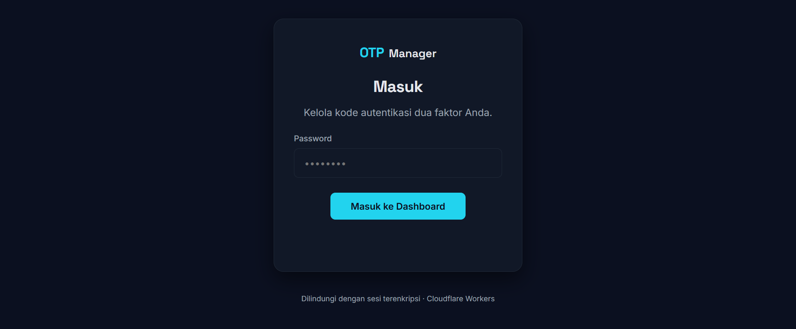
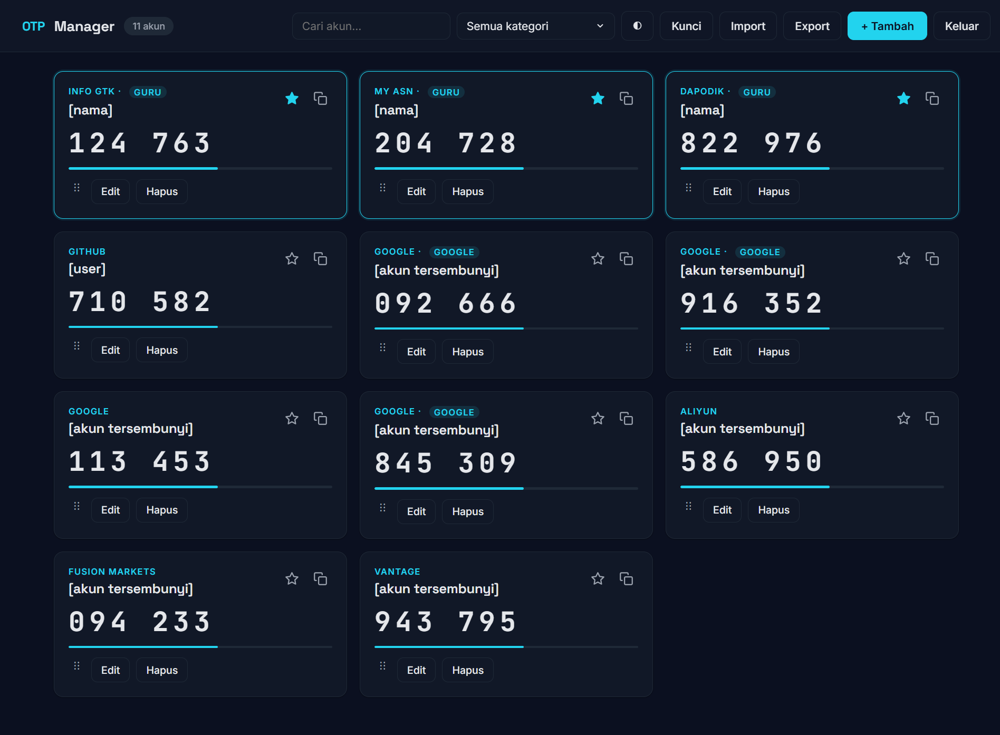

# OTP Manager

Manajer kode OTP (TOTP) dua faktor berbasis **Cloudflare Workers** + **Cloudflare KV**. Frontend statis, backend API di Worker, sesi via cookie HttpOnly.

**Production:** https://otp-manager.arvib-fazriansyah.workers.dev

## Screenshot

### Login


### Dashboard


> Data akun pada screenshot sudah disensor untuk privasi.

## Fitur

- Login dengan password (disimpan sebagai Worker secret)
- TOTP client-side (SHA-1/256/512, 6–8 digit, period 15–60s)
- Tambah / edit / hapus akun
- Scan QR via kamera atau unggah gambar
- Import & export (format `otpauth://`)
- Deduplikasi import berdasarkan secret (atau name+issuer)
- Pin/favorit + kategori/tag + filter
- Drag-and-drop reorder (tersimpan)
- Copy kode via ikon atau klik kode
- Custom modal konfirmasi hapus
- Toast modern (center-top)
- Auto-lock setelah 5 menit idle
- Tema dark/light
- Favicon

## Struktur

```
otp-manager/
├── public/          # frontend statis (index.html, style.css, app.js, favicon.svg)
├── src/index.js     # Worker API + KV logic
├── wrangler.jsonc   # config Worker, assets, KV
├── .env.example     # contoh env lokal
└── package.json
```

## Setup lokal

1. Install Wrangler: `npm i -g wrangler`
2. Login: `wrangler login`
3. Buat KV namespace, isi `id` di `wrangler.jsonc`
4. Buat `.dev.vars` (jangan commit):

```
PASSWORD=your_password_here
KV_KEY=otp:entries
```

5. Jalankan: `npm run dev` → http://127.0.0.1:8788

## Deploy

```bash
npm run deploy
```

Set secret production:

```bash
wrangler secret put PASSWORD
```

## Keamanan

- Password disimpan sebagai Worker secret, bukan di repo.
- `.env` dan `.dev.vars` di-gitignore.
- Sesi disimpan di KV dengan cookie `HttpOnly`, `Secure` di HTTPS.

## Lisensi

MIT
